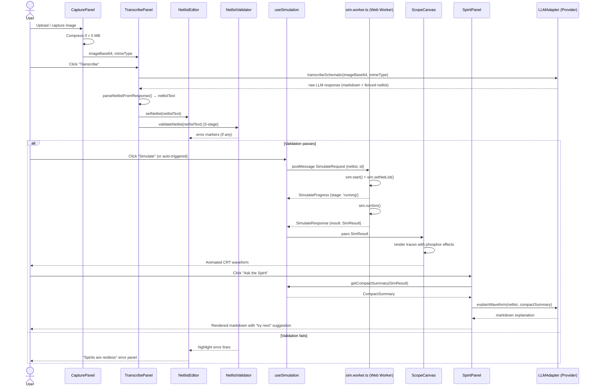

# Circuit Séance — Design

**Feature:** Circuit Séance MVP  
**Version:** 1.0  
**Date:** 2026-11-02

---

## 1. Architecture Overview

Circuit Séance is a fully static single-page application. There is no back-end; all computation (WASM simulation, LLM calls) originates in the browser. The architecture is divided into six feature domains that communicate through typed public barrel APIs, a shared library layer (`src/lib/`), and a cross-cutting shared-types layer (`src/shared/`).

```
┌────────────────────────────────────────────────────────────────────┐
│  Browser                                                           │
│  ┌──────────────────────────────────────────────────────────────┐  │
│  │  src/app  — Shell, routing, i18n                             │  │
│  │  ┌────────────┐  ┌─────────────┐  ┌──────────────────────┐  │  │
│  │  │  capture   │  │ transcribe  │  │       netlist        │  │  │
│  │  │  feature   │  │  feature    │  │       feature        │  │  │
│  │  └─────┬──────┘  └──────┬──────┘  └──────────┬───────────┘  │  │
│  │        │                │                     │              │  │
│  │        └────────────────┴─────────────────────┘              │  │
│  │                         │ netlist string                      │  │
│  │              ┌──────────▼──────────┐                         │  │
│  │              │   simulate feature  │◄──── Web Worker         │  │
│  │              │ (useSimulation hook)│      (eecircuit-engine)  │  │
│  │              └──────────┬──────────┘                         │  │
│  │                         │ SimResult                          │  │
│  │           ┌─────────────▼────────────┐                       │  │
│  │           │     scope feature        │                       │  │
│  │           │  (ScopeCanvas + knobs)   │                       │  │
│  │           └─────────────┬────────────┘                       │  │
│  │                         │ compact summary                    │  │
│  │              ┌──────────▼──────────┐                         │  │
│  │              │   spirit feature    │──► LLMAdapter           │  │
│  │              └─────────────────────┘   (openai / anthropic)  │  │
│  │                                                              │  │
│  │  src/lib/llm  — LLMAdapter interface + impls                 │  │
│  │  src/shared   — types, utils, constants                      │  │
│  └──────────────────────────────────────────────────────────────┘  │
│                                                                    │
│  External (user's own key, never project server)                   │
│  ┌──────────────────┐    ┌───────────────────┐                    │
│  │  OpenAI / compat │    │  Anthropic Claude  │                    │
│  └──────────────────┘    └───────────────────┘                    │
└────────────────────────────────────────────────────────────────────┘
```

### Key design decisions

| Decision | Rationale |
|---|---|
| Web Worker for WASM | ~40 MB WASM + simulation CPU must never jank the UI thread |
| Provider-agnostic `LLMAdapter` | New providers added without touching feature code |
| Barrel-only imports between features | Prevents fragile internal coupling |
| Canvas 2D (not WebGL) | Sufficient for 60 fps at ≤10k points; avoids WebGL context management overhead |
| `sessionStorage` default for API keys | Keys survive page refresh but not browser close; opt-in `localStorage` for persistence |
| Compact summary instead of raw arrays to LLM | Keeps prompt tokens small; avoids exposing raw float arrays that add no pedagogical value |

---

## 2. Component Diagram

```mermaid
graph TD
    subgraph "src/app"
        App["App.tsx\n(Shell + layout)"]
        Router["router.tsx"]
        I18n["i18n/en.ts\ni18n/zh-CN.ts"]
    end

    subgraph "features/capture"
        CapturePanel["CapturePanel.tsx"]
        useCapture["useCapture.ts"]
    end

    subgraph "features/transcribe"
        TranscribePanel["TranscribePanel.tsx"]
        useTranscribe["useTranscribe.ts"]
        LLMResponseParser["llm-response-parser.ts"]
    end

    subgraph "features/netlist"
        NetlistEditor["NetlistEditor.tsx\n(CodeMirror 6)"]
        SpiceMode["spice-mode.ts"]
        NetlistParser["netlist-parser.ts"]
        NetlistValidator["netlist-validator.ts"]
    end

    subgraph "features/simulate"
        useSimulation["useSimulation.ts"]
        SimWorker["sim.worker.ts\n(Web Worker)"]
        ResultSummariser["result-summariser.ts"]
    end

    subgraph "features/scope"
        ScopeCanvas["ScopeCanvas.tsx"]
        ScopeRenderer["scope-renderer.ts\n(Canvas 2D)"]
        ScopeControls["ScopeControls.tsx\n(knobs, channel select)"]
        PhosphorEffects["phosphor-effects.ts"]
    end

    subgraph "features/spirit"
        SpiritPanel["SpiritPanel.tsx"]
        useSpirit["useSpirit.ts"]
        OfflineExplainer["offline-explainer.ts"]
    end

    subgraph "src/lib/llm"
        LLMAdapter["adapter.ts\n(interface)"]
        OpenAIAdapter["openai.ts"]
        AnthropicAdapter["anthropic.ts"]
    end

    subgraph "src/shared"
        Types["types.ts"]
        Utils["utils.ts"]
    end

    subgraph "src/examples"
        ExampleNets["*.net files"]
    end

    App --> CapturePanel
    App --> TranscribePanel
    App --> NetlistEditor
    App --> ScopeCanvas
    App --> ScopeControls
    App --> SpiritPanel

    useTranscribe --> LLMAdapter
    useTranscribe --> LLMResponseParser
    useSpirit --> LLMAdapter
    useSpirit --> OfflineExplainer

    NetlistEditor --> SpiceMode
    NetlistEditor --> NetlistParser
    NetlistEditor --> NetlistValidator

    useSimulation --> SimWorker
    useSimulation --> ResultSummariser

    ScopeCanvas --> ScopeRenderer
    ScopeRenderer --> PhosphorEffects

    LLMAdapter <|.. OpenAIAdapter
    LLMAdapter <|.. AnthropicAdapter

    useSimulation --> Types
    ScopeRenderer --> Types
    useSpirit --> Types
```

---

## 3. Sequence Diagram — Photo → Netlist → Simulate → Explain



---

## 4. Data Models / TypeScript Interfaces

All interfaces are defined in `src/shared/types.ts` unless noted.

### 4.1 Simulation types

```ts
// Raw result from eecircuit-engine
interface SimResult {
  header: string;
  numVariables: number;
  variableNames: string[];
  numPoints: number;
  dataType: 'real' | 'complex';
  data: Array<{
    name: string;
    type: string;
    values: number[] | [number, number][]; // real or complex pairs
  }>;
}

type AnalysisType = 'tran' | 'ac' | 'dc' | 'op';

// Compact numeric digest passed to the LLM spirit
interface CompactSummary {
  analysisType: AnalysisType;
  tran?: {
    channels: Array<{
      name: string;
      min: number;
      max: number;
      final: number;
      tauEstimate: number | null;    // 63.2% rise time constant
      riseTime: number | null;       // 10%–90%
      overshootPct: number | null;
    }>;
  };
  ac?: {
    dcGainDb: number;
    minusThreeDbFreq: number | null; // Hz
    peakGainDb: number | null;
    peakFreqHz: number | null;
  };
  dc?: {
    sweepVar: string;
    outputVar: string;
    min: number;
    max: number;
    midSlopePerUnit: number;
  };
  op?: {
    nodeVoltages: Record<string, number>; // node name → volts
  };
}
```

### 4.2 Netlist parsing

```ts
// src/features/netlist/types.ts
type ComponentType =
  | 'R' | 'C' | 'L' | 'V' | 'I'
  | 'D' | 'Q' | 'M' | 'E' | 'F' | 'G' | 'H' | 'X';

interface NetlistComponent {
  type: ComponentType;
  name: string;       // e.g. "R1"
  nodes: string[];    // e.g. ["1", "2"]
  value: string;      // e.g. "10k"
  params: Record<string, string>;
  lineNumber: number;
}

type DirectiveType = 'tran' | 'ac' | 'dc' | 'op' | 'model' | 'subckt' | 'ends' | 'end' | 'other';

interface NetlistDirective {
  type: DirectiveType;
  raw: string;
  lineNumber: number;
}

interface ParsedNetlist {
  title: string;
  components: NetlistComponent[];
  directives: NetlistDirective[];
  errors: ParseError[];
}

interface ParseError {
  lineNumber: number;
  message: string;
  severity: 'error' | 'warning';
}
```

### 4.3 Validation

```ts
interface ValidationResult {
  valid: boolean;
  stage: 'syntax' | 'elements' | 'ngspice-dry-run' | 'passed';
  errors: ValidationError[];
}

interface ValidationError {
  lineNumber: number | null;
  message: string;       // human-readable, friendly
  rawMessage: string;    // raw ngspice or parser output
  severity: 'error' | 'warning';
}
```

### 4.4 LLM Adapter

```ts
// src/lib/llm/adapter.ts
interface LLMAdapter {
  transcribeSchematic(imageBase64: string, mimeType: string): Promise<string>;
  explainWaveform(
    netlist: string,
    summary: CompactSummary,
    language: 'en' | 'zh-CN',
  ): Promise<string>; // returns markdown
}

interface LLMConfig {
  provider: 'openai' | 'anthropic';
  apiKey: string;
  baseUrl?: string;   // OpenAI-compatible only; default https://api.openai.com/v1
  model?: string;     // override default model
}

class LLMError extends Error {
  provider: 'openai' | 'anthropic';
  statusCode: number;
  // message inherited from Error
}
```

### 4.5 Worker message protocol

```ts
// src/features/simulate/worker-protocol.ts

interface SimulateRequest {
  type: 'simulate';
  id: string;
  netlist: string;
}

interface SimulateResponse {
  type: 'result';
  id: string;
  result: SimResult;
}

interface SimulateError {
  type: 'error';
  id: string;
  message: string;  // friendly message
  raw: string;      // raw ngspice stderr/output
}

interface SimulateProgress {
  type: 'progress';
  id: string;
  stage: 'loading' | 'running';
}

type WorkerInbound = SimulateRequest;
type WorkerOutbound = SimulateResponse | SimulateError | SimulateProgress;
```

### 4.6 Scope display state

```ts
// src/features/scope/types.ts
interface ChannelConfig {
  variableName: string;        // matches SimResult.data[i].name
  color: PhosphorColor;
  voltsPerDiv: number;
  offsetDivisions: number;
  enabled: boolean;
}

type PhosphorColor = 'p31-green' | 'p31-yellow' | 'p31-blue' | 'p31-white';

interface ScopeViewState {
  analysisType: AnalysisType;
  channels: ChannelConfig[];   // up to 4
  timePerDiv: number;          // seconds (tran) | log-decade (ac)
  triggerChannel: number;
  graticule: boolean;
}
```

### 4.7 Application settings (persisted)

```ts
// src/shared/types.ts
interface AppSettings {
  llm: LLMConfig | null;
  storageMode: 'session' | 'local';   // where to persist the API key
  language: 'en' | 'zh-CN';
}
```

---

## 5. Feature Module Details

### 5.1 `features/capture`

- `CapturePanel.tsx` — renders the image preview, "Capture" and "Upload" buttons, and file size warning.
- `useCapture.ts` — manages `File` → `dataURL` → `imageBase64` conversion; client-side compression via Canvas `toDataURL('image/jpeg', 0.85)` if size > 5 MB.
- Public API: `{ CapturePanel, useCapture }`, `type { CapturedImage }`.

### 5.2 `features/transcribe`

- `TranscribePanel.tsx` — side-by-side photo / netlist view; "Transcribe" button; confidence note badge.
- `useTranscribe.ts` — calls `LLMAdapter.transcribeSchematic`, owns loading / error state.
- `llm-response-parser.ts` — `parseNetlistFromResponse(raw: string): { netlist: string; note: string } | ParseFailure`. Extracts first fenced block tagged `spice` or plain ` ``` `.
- Public API: `{ TranscribePanel, useTranscribe }`, `type { TranscribeState }`.

### 5.3 `features/netlist`

- `NetlistEditor.tsx` — CodeMirror 6 wrapper; wires spice-mode, linting extensions, error markers.
- `spice-mode.ts` — lezer-based or `StreamLanguage`-based tokeniser for SPICE; tokens: component, directive, model, comment, node, value.
- `netlist-parser.ts` — `parseNetlist(text: string): ParsedNetlist`. Pure function, no side effects.
- `netlist-validator.ts` — `validateNetlist(parsed: ParsedNetlist, dryRun: (nl: string) => Promise<string>): Promise<ValidationResult>`. Three-stage pipeline.
- Public API: `{ NetlistEditor, parseNetlist, validateNetlist }`, `type { ParsedNetlist, ValidationResult }`.

### 5.4 `features/simulate`

- `useSimulation.ts` — React hook that manages a singleton `Worker` reference, request queuing (only one simulation at a time), progress state, and result caching keyed by netlist hash.
- `sim.worker.ts` — Web Worker entry point; lazy-imports `eecircuit-engine`, runs `Simulation`, posts typed messages back.
- `result-summariser.ts` — `summariseResult(result: SimResult, type: AnalysisType): CompactSummary`. Pure function.
- Public API: `{ useSimulation, summariseResult }`, `type { SimResult, CompactSummary, SimulationState }`.

### 5.5 `features/scope`

- `ScopeCanvas.tsx` — React wrapper; owns canvas ref, ResizeObserver, RAF loop, keyboard/touch handler for knobs.
- `scope-renderer.ts` — `ScopeRenderer` class; `draw(state, simResult, timestamp)` called from RAF. Owns off-screen buffer for persistence/afterglow.
- `phosphor-effects.ts` — `applyGlow(ctx, color)`, `applyPersistence(ctx, prev, decay)`, `applyScanlines(ctx)`, `applyFlicker(ctx, timestamp)`. Each is a pure canvas operation, togglable.
- `ScopeControls.tsx` — volts/div knob (scroll wheel + drag), time/div knob, channel enable/color pickers, analysis-type-specific controls.
- Public API: `{ ScopeCanvas, ScopeControls }`, `type { ScopeViewState, ChannelConfig }`.

### 5.6 `features/spirit`

- `SpiritPanel.tsx` — Markdown renderer (via `marked` or `remark`), "Ask the Spirit" button, offline badge.
- `useSpirit.ts` — calls `LLMAdapter.explainWaveform`, tracks loading / error state, falls back to offline explainer.
- `offline-explainer.ts` — `getOfflineExplanation(exampleId: string, summary: CompactSummary): string`. Returns pre-written Markdown keyed by the six example IDs.
- Public API: `{ SpiritPanel, useSpirit }`.

---

## 6. Web Worker Architecture

```
Main Thread                          sim.worker.ts
────────────────────────────────     ───────────────────────────────────
useSimulation                        (lazy import eecircuit-engine)
  ├─ new Worker('./sim.worker.ts')
  │
  ├─ postMessage(SimulateRequest)  →  onmessage: SimulateRequest
  │                                    │
  │  ← SimulateProgress('loading')  ←  postMessage if WASM not yet loaded
  │                                    │  await import('eecircuit-engine')
  │  ← SimulateProgress('running')  ←  sim.start() + sim.setNetList()
  │                                    │  sim.runSim()
  │  ← SimulateResponse             ←  postMessage SimulateResponse
  │    OR SimulateError             ←  catch → postMessage SimulateError
```

The Worker keeps a single `Simulation` instance alive between runs. When a new netlist arrives it calls `sim.setNetList(netlist)` and `sim.runSim()` without re-creating the WASM instance. This avoids the ~200 ms startup cost on every run.

---

## 7. CRT Oscilloscope Rendering

### 7.1 Rendering pipeline (per animation frame)

```
1. Clear back-buffer (with slight alpha < 1 for persistence decay)
2. Draw graticule (10×8 divisions, centre ticks, phosphor tint grid)
3. For each enabled channel:
   a. Project data points into canvas coordinates (volts/div, time/div)
   b. Stroke path with phosphor colour
   c. Apply glow: two radial shadow passes (inner bright, outer dim halo)
4. Copy back-buffer to screen canvas
5. Overlay scanlines (horizontal semi-transparent lines every 2px)
6. Apply flicker: slight global alpha oscillation at ~0.5–2 Hz random walk
7. Draw labels and channel indicators
```

### 7.2 Phosphor colours

| Channel | Base hex | Glow colour |
|---|---|---|
| CH1 | `#39ff14` | `#39ff14` at 40% alpha |
| CH2 | `#aaff44` | `#aaff44` at 35% alpha |
| CH3 | `#ccff88` | `#ccff88` at 30% alpha |
| CH4 | `#e8ffbb` | `#e8ffbb` at 25% alpha |

### 7.3 Persistence / afterglow

The renderer maintains a secondary off-screen canvas (`persistCanvas`). Each frame, `persistCanvas` is drawn to `screenCanvas` with `globalAlpha = 0.85` before the new trace, creating a ~0.5 s natural decay. When `prefers-reduced-motion` is active, `persistCanvas` is not used and each frame fully clears before drawing.

### 7.4 Performance budget

- 10k points × 4 channels = 40k `lineTo` calls per frame.
- Path is batched into a single `beginPath` / `stroke` per channel.
- Glow effect uses `shadowBlur` on context; if frame time exceeds 16 ms for two consecutive frames, glow is automatically reduced in `shadowBlur` radius.

### 7.5 Analysis-type views

| Analysis | X axis | Y axis | Notes |
|---|---|---|---|
| `.tran` | time (s) | voltage / current | up to 4 channels |
| `.ac` | log₁₀ frequency (Hz) | magnitude (dB) + phase (°) | dual-pane or overlaid |
| `.dc` | sweep variable | output variable | single channel |
| `.op` | — | — | node-voltage table replaces canvas |

---

## 8. LLM Adapter Design

### 8.1 Interface (`src/lib/llm/adapter.ts`)

```ts
interface LLMAdapter {
  transcribeSchematic(imageBase64: string, mimeType: string): Promise<string>;
  explainWaveform(
    netlist: string,
    summary: CompactSummary,
    language: 'en' | 'zh-CN',
  ): Promise<string>;
}
```

### 8.2 OpenAI-compatible adapter

- POST to `${baseUrl}/chat/completions`
- System prompt: instructs model to output exactly one fenced `spice` code block followed by a confidence note.
- Image passed as `{ type: 'image_url', image_url: { url: 'data:{mimeType};base64,{imageBase64}' } }`.
- `explainWaveform` sends netlist + JSON-serialised summary; system prompt requests undergraduate-level explanation + one "try next" suggestion, in the requested language.

### 8.3 Anthropic adapter

- POST to `https://api.anthropic.com/v1/messages`
- Image passed as `{ type: 'image', source: { type: 'base64', media_type: mimeType, data: imageBase64 } }`.
- Same prompt structure as OpenAI adapter.

### 8.4 LLM response parsing (`features/transcribe/llm-response-parser.ts`)

```
1. Find first occurrence of ```spice or ``` (case-insensitive)
2. Extract content up to closing ```
3. Trim whitespace
4. Look for any text after the closing ``` as the confidence note
5. Return { netlist: string, note: string } | { error: 'no-fence' | 'empty-fence' }
```

---

## 9. i18n Strategy

- String keys are defined once in `src/app/i18n/en.ts` and mirrored in `zh-CN.ts`.
- A lightweight `useTranslation()` hook reads the active locale from `AppSettings.language`.
- No external i18n library is required for the MVP (the string maps are small enough for a plain `Record<string, string>` lookup).
- All user-visible strings — including error messages, ARIA labels, and spirit prompts — must have entries in both locale files.

---

## 10. Error Handling Strategy

| Error source | Handler location | User presentation |
|---|---|---|
| Netlist syntax error | `netlist-validator.ts` | Error markers in editor + validation panel |
| ngspice element/node error | `netlist-validator.ts` | "Spirits are restless" panel, collapsible raw error |
| ngspice runtime error | `sim.worker.ts` → `SimulateError` | Same panel; if pattern recognised → suggest fix |
| LLM network / auth error | `useTranscribe` / `useSpirit` | Toast or inline error message with specific reason |
| LLM response parse failure | `llm-response-parser.ts` → typed error | "Spirit could not read circuit" + manual entry prompt |
| Image too large | `useCapture.ts` | Warning in capture panel; auto-compress |
| Browser unsupported (no File API) | `CapturePanel.tsx` | Static unsupported-feature notice |

All errors must be logged to `console.error` in development mode, and swallowed silently (or shown as friendly messages) in production.

---

## 11. Settings & Key Storage

API keys are stored exclusively in the browser:

- `sessionStorage` (default): key survives page refresh but not browser close.
- `localStorage` (opt-in): key persists across browser sessions; user explicitly enables this.

The key is never included in URLs, query strings, Vite env files, or source code. On the settings UI, the key is masked after entry (`sk-…last4`). The full key is read from storage only at the moment of an LLM request.

---

## 12. Folder / File Checklist

```
src/
├── app/
│   ├── App.tsx
│   ├── router.tsx
│   └── i18n/
│       ├── en.ts
│       └── zh-CN.ts
├── features/
│   ├── capture/
│   │   ├── index.ts
│   │   ├── CapturePanel.tsx
│   │   └── use-capture.ts
│   ├── transcribe/
│   │   ├── index.ts
│   │   ├── TranscribePanel.tsx
│   │   ├── use-transcribe.ts
│   │   └── llm-response-parser.ts
│   ├── netlist/
│   │   ├── index.ts
│   │   ├── NetlistEditor.tsx
│   │   ├── spice-mode.ts
│   │   ├── netlist-parser.ts
│   │   ├── netlist-validator.ts
│   │   └── types.ts
│   ├── simulate/
│   │   ├── index.ts
│   │   ├── use-simulation.ts
│   │   ├── sim.worker.ts
│   │   ├── result-summariser.ts
│   │   └── worker-protocol.ts
│   ├── scope/
│   │   ├── index.ts
│   │   ├── ScopeCanvas.tsx
│   │   ├── ScopeControls.tsx
│   │   ├── scope-renderer.ts
│   │   ├── phosphor-effects.ts
│   │   └── types.ts
│   └── spirit/
│       ├── index.ts
│       ├── SpiritPanel.tsx
│       ├── use-spirit.ts
│       └── offline-explainer.ts
├── lib/
│   └── llm/
│       ├── adapter.ts
│       ├── openai.ts
│       └── anthropic.ts
├── examples/
│   ├── rc-lowpass.net
│   ├── rl.net
│   ├── rlc-ringing.net
│   ├── diode-rectifier.net
│   ├── bjt-common-emitter.net
│   └── opamp-inverting.net
└── shared/
    ├── types.ts
    └── utils.ts
tests/
├── unit/
│   ├── features/
│   │   ├── netlist/
│   │   │   ├── netlist-parser.test.ts
│   │   │   ├── netlist-parser.property.test.ts  (fast-check)
│   │   │   └── netlist-validator.test.ts
│   │   ├── simulate/
│   │   │   └── result-summariser.test.ts
│   │   └── transcribe/
│   │       └── llm-response-parser.test.ts
│   └── lib/
│       └── llm/
│           └── adapters.test.ts
├── e2e/
│   └── smoke.spec.ts
└── fixtures/
    └── netlists/
        └── (example netlists for tests)
```

---

## 13. Testing Strategy

### Unit tests (Vitest)

| File | Coverage target |
|---|---|
| `netlist-parser.test.ts` | ≥ 20 representative lines; component types, node names, directives, comments |
| `netlist-parser.property.test.ts` | fast-check: `serialise(parse(nl)) === normalise(nl)` for well-formed inputs |
| `netlist-validator.test.ts` | accepts valid; rejects missing-ground, floating nodes, bad directives |
| `result-summariser.test.ts` | τ, rise-time, overshoot, –3 dB freq against known fixtures |
| `llm-response-parser.test.ts` | fenced-block extraction, no-fence error, empty-fence error |

### End-to-end (Playwright)

`smoke.spec.ts`:
1. Navigate to `http://localhost:5173`.
2. Click the RC low-pass example.
3. Wait for `[data-testid="scope-canvas"]` to be visible and for `[data-testid="sim-status"]` to contain "complete".
4. Assert the canvas `data-has-trace="true"` attribute is set (set by the renderer after first draw).

### CI requirements

- `npm test` (Vitest single-run) must pass before merge.
- `npm run lint` must pass before merge.
- Playwright smoke test runs in CI on the built bundle (`npm run build && npx playwright test`).
