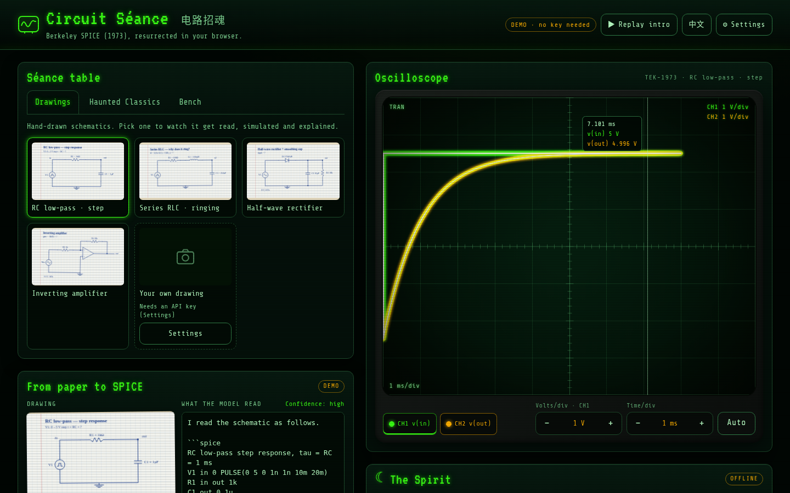
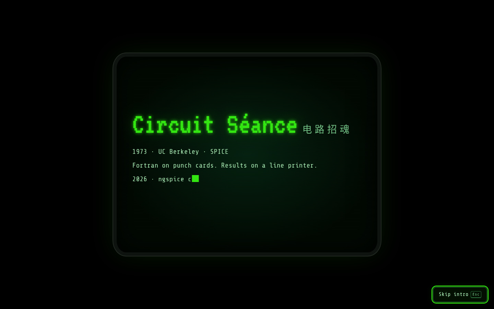
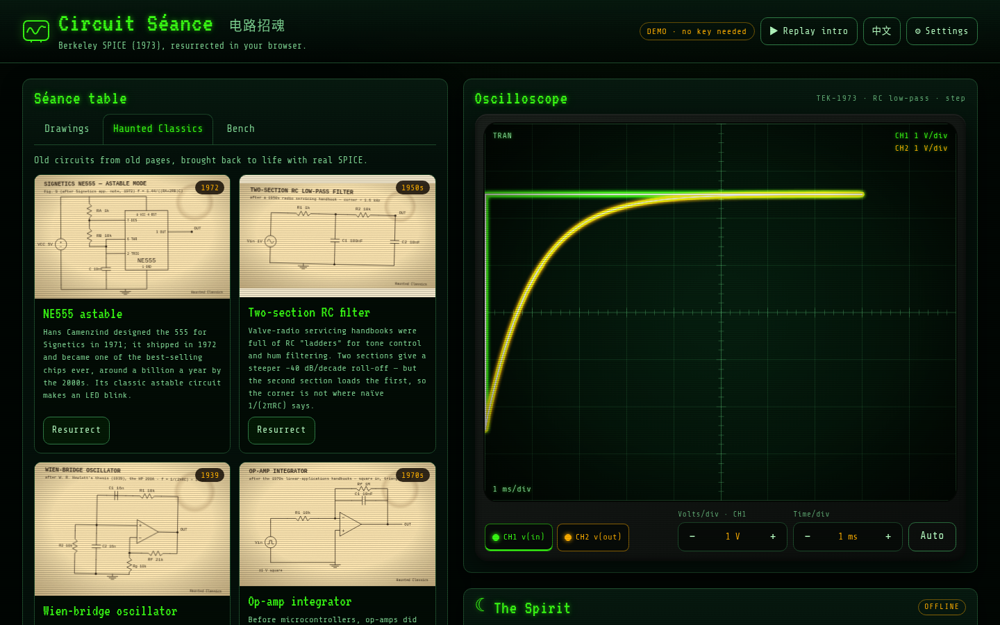
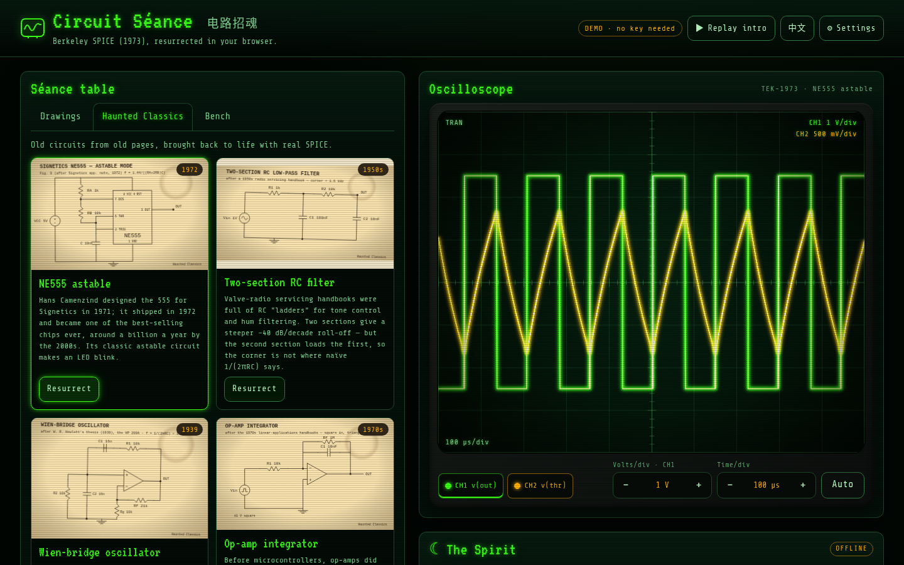
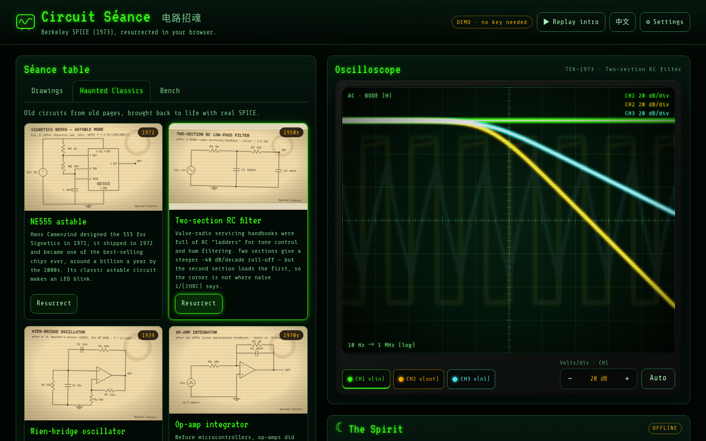
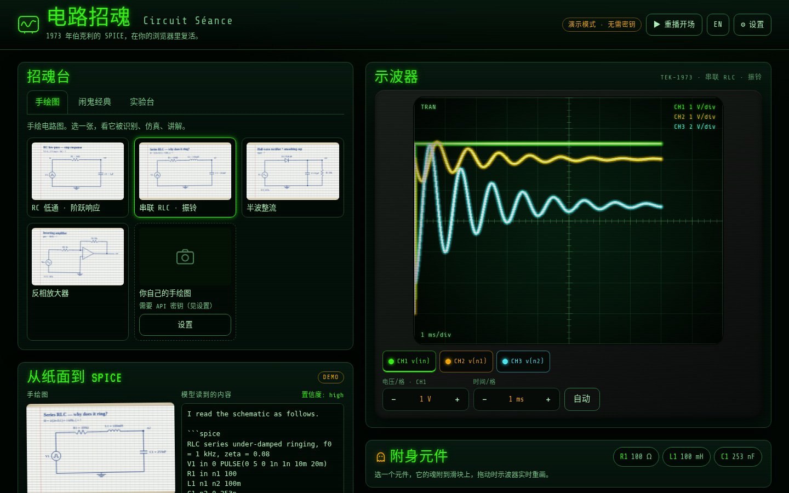
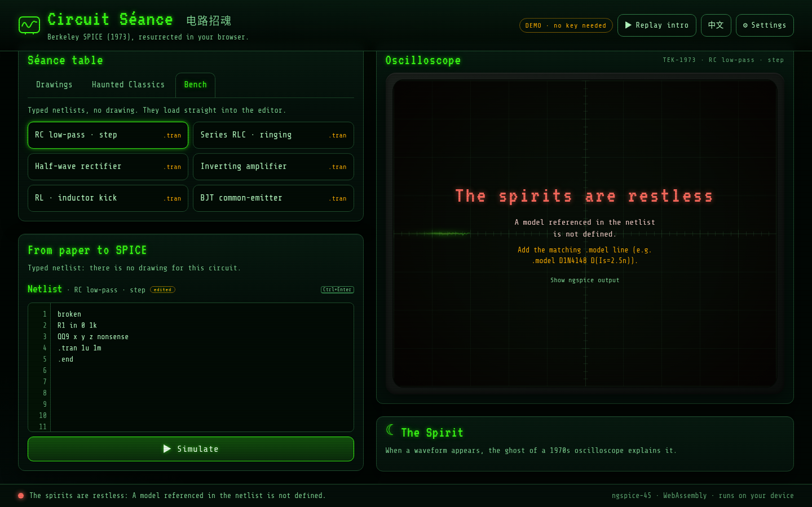

# Circuit Séance · 电路招魂

> **Berkeley SPICE (1973), resurrected in your browser.**
> Draw a circuit. A vision model reads it, half-century-old SPICE simulates it, and the waveform glows on a haunted green-phosphor oscilloscope while its resident spirit explains what you're seeing, in English or 简体中文.

**Kiroween 2026 · Resurrection** · also entered in **LaunchPad Hacks** · MIT licensed · runs entirely client-side



**Demo video (2:12, English captions burned in):** [`docs/demo/circuit-seance-demo.mp4`](docs/demo/circuit-seance-demo.mp4), recorded automatically from the real app by [`tools/record-demo.mjs`](tools/record-demo.mjs). *(YouTube link: added once the owner uploads it.)*

**For EE students:** check your homework and lab circuits before you hand them in. Draw it, simulate it, compare it with your hand calculation (±5 %), and drag any R, C or L to *see* why the answer is what it is. It works in English and 简体中文 and needs no install or account. It also runs offline, and in mainland China: no Google Fonts, no CDN, no blocked services.

---

## Judge quickstart (no key, about 2 minutes)

```bash
npm ci
npm run build && npx vite preview      # → http://localhost:4173
```

1. **First visit plays a short séance intro** (6.5 s, skip with `Esc`). It then summons the RC demo by itself: the hand-drawn schematic appears, its recorded vision-model transcription types out, the netlist goes into the editor, ngspice runs, and the trace sweeps across the CRT. A waveform shows up in **about 8.4 s from page load, intro included** (that's what the e2e test measures).
2. **Drawings** tab: three more hand-drawn sheets (series RLC ringing, half-wave rectifier, inverting amplifier).
3. **Haunted Classics** tab: four circuits from old pages, each with its history: the **NE555 astable (1972)**, **Hewlett's Wien-bridge oscillator (1939, HP's first product)**, a 1950s two-section RC filter (Bode plot), and the 1970s op-amp integrator.
4. **Edit the netlist** (for example change `C1 out 0 1u` to `2.2u`) and press **Ctrl+Enter**. The spirit switches from the canned story to a reading of the new measurements, and the **Homework check** tells you whether your hand-calculated τ is within ±5 %.
5. Hover the screen to read values with the cursor. With the screen focused, ↑/↓ change volts/div, ←/→ change time/div, keys 1–4 pick a channel, and `A` auto-scales.
6. **Possess a component** (new): under the scope, click a part such as **C1** and drag its slider (÷10 … ×10, log scale). ngspice re-runs on every move, the CRT keeps its scales and shows the original trace as a dashed ghost, and the readout tracks the measured physics (τ 1.00 ms → 2.19 ms, ×2.19). **Release** restores the value.
7. **中文** in the top bar switches the whole UI and the spirit to Chinese.

Demo mode makes **zero network requests**. The Playwright suite blocks and records every non-localhost request and checks the list is empty. The BYOK path (photo → vision model → netlist → simulate → live spirit) is covered end-to-end against a mocked DashScope endpoint, and DashScope, OpenAI and Gemini all accept browser CORS preflights, so keys work straight from a static site. Add `?nointro` to the URL to skip the intro.

**How accurate is the photo reading?** Measured only on 12 synthetic hand-drawn-style images so far, not on real phone photos. `tools/eval-vision.mjs` simulates the model's netlist and the true one in ngspice and compares key measurements within ±5 %, plus every R/L/C value. On the free AMD Radeon Token Factory tier, Gemma-4-31B-IT gets 10/12 fully right with the built-in op-amp/555 library (7/12 before it; one answer per image, and the 7 that already passed were not re-sent with the new prompt). MiniCPM-V-4.7-35B-A3B gets 5/12. Details, caveats and rerun commands: [docs/vision-eval.md](docs/vision-eval.md).

**Optional (bring your own key):** ⚙ Settings → provider (**Qwen-VL / DashScope is the default**; OpenAI and Gemini are presets, and **OpenAI-compatible (custom base URL)** takes any gateway or relay that speaks `/chat/completions`: type its base URL and model, requests wait up to 90 s) → paste a key. That unlocks two things: **reading your own photo** of a hand-drawn circuit, and **asking the live spirit** about any circuit. The key is stored **only in this browser's `localStorage`** and sent only to the base URL you set. There is no server.

---

## Why it's a Resurrection

| 1973 | 2026 |
|------|------|
| **SPICE1** is presented by Laurence Nagel and Donald Pederson at **UC Berkeley**: Fortran, punch cards, results on a line printer | The open-source descendant of Berkeley SPICE3, **ngspice 45**, compiled to **WebAssembly** ([`eecircuit-engine`](https://github.com/eelab-dev/EEcircuit-engine), MIT), runs in a Web Worker on your laptop or phone |
| You read the waveform on a **phosphor CRT oscilloscope** | A Canvas CRT with phosphor persistence, a beam sweep, scanlines and real 1-2-5 volts/div knobs |
| A lab TA explains the trace | The **spirit**: an offline explainer that quotes the *measured* numbers and compares them with textbook theory (or a live LLM if you add a key) |
| The circuit lives on a page in a 1972 app note | **Haunted Classics** puts those pages back on the bench |

Nothing here is a mock. Every curve is a real ngspice transient, AC or operating-point analysis, and `tests/integration/catalog.test.ts` runs every bundled circuit through the engine and checks the numbers the spirit quotes (RC τ = 1 ms, RL τ = 100 µs, RLC rings near 1 kHz, inverting gain −10, NE555 ≈ 6.86 kHz, Wien bridge ≈ 995 Hz, a 5 V pk-pk integrator triangle, the RC-ladder −3 dB corner).

## Who it's for

EE students who have a textbook and a pencil but no bench oscilloscope, no SPICE licence, and maybe no laptop that can install one. Draw the circuit from your homework, see the real waveform, check your hand calculation, and read why it looks the way it does, in your own language. It works on a phone.

## How it works

```
hand-drawn sheet ──► vision LLM (recorded in demo / Qwen-VL live) ──► ```spice block ──► parser
      │                                                                                 │
      ▼                                                                                 ▼
 Séance table  ─────────────────────────────────────────────────────────► editable netlist (Ctrl+Enter)
                                                                                        │ ASCII sanitiser
                                                                                        ▼
                                              Web Worker: ngspice-45 WASM (one engine, serialised runs, timeout)
                                                                                        │ SimResult
                                       ┌────────────────────────────────────────────────┴───────────────┐
                                       ▼                                                                ▼
                         CRT <Scope/> (Canvas 2D, persistence,                       measure(): τ (63 % or 3-point fit),
                         sweep, cursor, knobs, Bode, .op table)                      f, rise, overshoot, ripple, −3 dB, gain
                                                                                                        │
                                                                     offline spirit (EN/中文) · live spirit (LLM) · homework ±5 %
```

- **Stack:** Vite 6, React 18, TypeScript (strict), Canvas 2D, Web Worker, `eecircuit-engine` 1.9 (ngspice 45 WASM), `marked` (HTML is escaped before rendering, so model output can't inject markup), self-hosted fonts (`@fontsource/vt323`, `share-tech-mono`), because Google Fonts is blocked in mainland China.
- **Things we learned the hard way** (all handled in the worker): a single non-ASCII byte (`µ`, `Ω`, a Chinese comment) makes ngspice hang forever, so every netlist is folded to ASCII first. Two engine instances in one worker also hang, so there's one shared `start()` promise and runs are queued. ngspice doesn't always report failure, so "no output variables" counts as an error.
- **Accessibility:** keyboard-operable tabs, knobs and dialogs, a visible phosphor focus ring, an `aria-live` status bar, a text description of the plot for screen readers, and **`prefers-reduced-motion`** respected everywhere (static intro, no sweep, no flicker). Contrast is ≥ 4.5:1. The layout is responsive down to 360 px.
- **States:** intro, empty ("NO SIGNAL"), loading ("Waking ngspice…" on first run), summoning, complete, error ("The spirits are restless", with a friendly cause, a fix hint and the raw ngspice output behind a disclosure), plus live-LLM loading and error.

## How Kiro was used

Everything under [`.kiro/`](.kiro) was written by **kiro-cli** (2.37, headless `--no-interactive`, `stream-json`), never by hand. Every prompt and the full event stream of every run is in [`docs/kiro-runs/`](docs/kiro-runs). Commands and credits per run are in [`docs/kiro-usage-log.md`](docs/kiro-usage-log.md).

- **Steering:** `product.md`, `tech.md`, `structure.md` (always included).
- **Spec-driven development:** `--mode spec` produced `requirements.md` with **EARS** acceptance criteria (11 story groups, ~98 SHALL statements), a `design.md` (mermaid diagrams, TS interfaces, worker protocol), and a `tasks.md` where every task links back to its requirements. An amendment run (v1.1) added Demo Séance, the Qwen-VL default, Haunted Classics, the homework check and the SPICE MCP server. Implementation ran in **headless task waves** ("implement tasks 1–4", "5–8", "9–11", "13–15/24") against that spec, and Kiro ticked tasks off as it went.
- **Agent hooks, firing headless:** two `PostFileSave` **command hooks** (`lint-on-save` runs ESLint + Prettier on the saved file; `netlist-guard` runs the related netlist tests) and two **agent-prompt hooks** (`i18n-sync` keeps zh-CN in step with en; `spirit-tone` reviews every save under `src/lib/llm` and `src/features/spirit` for API-key leakage, raw waveform arrays in prompts, and the spirit's voice). The transcripts record **126 `hook_update` events** during headless runs; see the table in the usage log.
- **Headless automation:** a small wrapper (`docs/kiro-runs/run.sh`, `bg.sh`) runs Kiro detached, saves the transcript and adds up the credits from `promptTurnSummaries`.
- **What Kiro wrote:** the scaffold and tooling, i18n, the six example circuits (four needed hand fixes, see below), the netlist parser and validator, the first simulation worker, the result summariser, the LLM adapter layer (Qwen-VL / OpenAI / Gemini presets, prompts, the response parser) and about 66 unit tests.

### Honest disclosure: what was written by hand

The Kiro free tier (≈ 31–36 credits used) ran out partway through implementation, so a large part of the shipped app was written by hand. Every file is listed in [`docs/kiro-runs/hand-fixes.md`](docs/kiro-runs/hand-fixes.md). In short:

- **By hand:** the possess-a-component feature, the demo-video recorder, the final simulation worker, the CRT `<Scope/>` and its renderer, waveform measurement and the offline spirit, the Haunted Classics catalogue and its netlists, the schematic-drawing generator (`scripts/gen-schematics.py`), the **entire UI wiring** (`App.tsx`, intro, séance table, transcription stage, spirit panel, settings, CSS), the integration and e2e tests, and these docs.
- **Fixed by hand:** four of Kiro's example netlists that were electrically wrong, build blockers left by a killed run, a timeout bug in the LLM adapter, and an ESLint config that flagged every TypeScript file.
- **Queued for Kiro** once the 4,000-credit grant arrives ([`docs/next-kiro-passes.md`](docs/next-kiro-passes.md)): the **SPICE MCP server** (spec task 29) so Kiro can simulate netlists itself, a Kiro **ownership/review pass** over every hand-written file against the EARS requirements, and the rest of the `tasks.md` status sync.

## Development

```bash
npm ci
npm run dev                 # http://localhost:5173
npm test                    # 134 unit + integration tests (vitest; integration runs the real engine)
npm run build               # tsc -b + vite build → dist/ (static; the engine is a lazy ~20 MB chunk)
npm run lint                # ESLint (type-aware) on src/
npm run test:e2e            # Playwright (13 tests) against vite preview; set CHROMIUM_PATH if needed
PW_FIREFOX=1 npm run test:e2e -- --project=firefox   # same suite in Firefox (npx playwright install firefox)
node tools/record-demo.mjs  # re-record docs/demo/circuit-seance-demo.mp4 (needs a build, Chromium and ffmpeg)
npm run screenshots         # regenerate docs/screenshots/
npm run verify:netlists     # every bundled netlist through ngspice in Node
```

The app deploys as static files (any static host). `VITE_BASE_URL` sets the base path.

## Screenshots

| | |
|---|---|
|  |  |
|  |  |
|  |  |

Possess a component: [`13-possess.png`](docs/screenshots/13-possess.png). Phone: [`11-mobile.png`](docs/screenshots/11-mobile.png), [`12-mobile-full.png`](docs/screenshots/12-mobile-full.png). Homework check: [`08-homework.png`](docs/screenshots/08-homework.png). Settings: [`10-settings.png`](docs/screenshots/10-settings.png).

## Credits

- ngspice: the ngspice team, descended from Berkeley SPICE (L. W. Nagel, D. O. Pederson, UC Berkeley, 1973).
- [`eecircuit-engine`](https://github.com/eelab-dev/EEcircuit-engine): ngspice compiled to WebAssembly (MIT).
- Fonts: VT323 and Share Tech Mono (SIL OFL), via Fontsource.

## License

[MIT](LICENSE) © 2026 Cao Xiaoqing
